# Claude Pet

Una mascota viva arriba del chat de **Claude Code / Claude Desktop**: una mascota en pixel art (por defecto se llama Claude; ponle el nombre que quieras) con su
red neuronal circular, que reacciona en tiempo real a lo que hace Claude y te muestra lo que importa
de la sesión.



## Qué hace

**Reacciona a la sesión**

| Lo que pasa | Lo que ves |
|---|---|
| Lees tu mensaje / Claude piensa | Burbuja de pensamiento · «Pensando…» |
| Claude escribe la respuesta | Teclea, mueve la boca y llena una hojita · «Escribiendo respuesta…» |
| Usa herramientas | «Editando main.cpp», «$ npm test», «Skill: pdf», «figma: get_screenshot» |
| **Te necesita** | Brazos arriba, «!» amarillo: permiso, pregunta de opción múltiple o plan listo |
| Subagentes | Mini-mascotas de colores en corona sobre su cabeza (uno por subagente) |
| Error / compactar / cancelar | Triste, mareado, «me voy a las montañas…» |
| Sin actividad 90 s | Se duerme (Zzz) |

**Memes** (momentáneos, se pueden apagar): lentes *deal with it* tras 15 pasos sin errores
(vibe coding), *this is fine* al 3.er error, *absolute cinema* en turnos con 5+ archivos.

**Datos útiles de la sesión**

```
Luffy  ESP32  ⎇ main
ctx 42% · 84k/200k · 5h 37% · reinicia 18:40            (+ «compacta pronto» ≥85%, «semana 64%» ≥60%)
Editando register.tsx
◆ 3/7 · Implementando el radar                           (lista de tareas de Claude)
◇ 2 subagentes · Explorando el repo
⏳ 1 en segundo plano · despierta 18:40
● arregla el sensor   ESP32   te necesita · Necesita tu permiso · Bash
● revisa el README    Ideas   escribiendo · 3m
```

Al terminar un turno: `Tu turno · 1m 12s · register.tsx, scene.ts +3`.

**Radar de conversaciones**: las últimas 3 conversaciones con actividad real en la última hora,
con su estado (te necesita, trabajando, te espera, en pausa). Cada conversación deja su estado en
`~/.claude/claude-pet/sesiones/`; nada sale de tu computadora.

## Personalízalo

```
/pet                      muestra u oculta
/pet demo                 todas las animaciones (~60 s)
/pet nombre Luffy
/pet color azul           naranja, azul, cian, verde, morado, rosa, rojo, amarillo, gris, blanco o #hex
/pet accesorio paja       paja, ninja, saiyan, neko, pirata, gorro, corona, moño, audifonos, fiesta, ninguno
/pet sonido on            campanita cuando te necesita o termina un turno largo
/pet nivel                 10 etapas por tokens trabajados (Huevo → … → Deidad del Código) y logros
/pet tarjeta              imagen para compartir (PNG en tu Escritorio)
/pet comentarios on       la IA comenta lo que hace Claude (gasta tokens; apagado por defecto)
/pet memes off
/pet radar off
/pet ayuda
```

Las preferencias se guardan para todas tus conversaciones.

## Instalar

Desde GitHub:

```
/plugin marketplace add leonardos4enz/claude-pet
/plugin install claude-pet@claude-pet
```

o desde una copia local:

```bash
claude plugin marketplace add ./ruta/a/esta/carpeta
claude plugin install claude-pet@claude-pet --scope user
```

Requisitos: un Claude Code con **mods** (hooks de funciones). Claude Desktop los carga solo; en la
terminal, mientras sigan en acceso anticipado, hace falta `CLAUDE_CODE_ENABLE_FUNCTION_HOOKS=1`.

Apagarlo / encenderlo en todas las conversaciones:

```bash
claude plugin disable claude-pet@claude-pet
claude plugin enable claude-pet@claude-pet
```

## Notas

- **Permisos en modo auto**: la alerta espera 4 s; si el modo auto aprueba solo antes, no aparece.
- **Sonido en Windows**: se reproduce con el reproductor del sistema (PowerShell); en macOS con el de la API.
- **Segundo plano**: el conteo es aproximado (la API no avisa cuándo termina un proceso de fondo);
  se reinicia con tu siguiente mensaje.
- El radar limpia solo los archivos de conversaciones cerradas o con más de un día sin señal.

## Desarrollo

```bash
claude plugin validate claude-pet
CLAUDE_CODE_ENABLE_FUNCTION_HOOKS=1 claude plugin test claude-pet
```

- `claude-pet/hooks/scene.ts` — funciones puras: estado → SVG (la mascota, red neuronal, efectos,
  accesorios en pixel art), formatos, radar y comandos de `/pet`.
- `claude-pet/hooks/register.tsx` — los eventos de la sesión, la banda (`AbovePrompt`), el radar y el sonido.
- `claude-pet/types/index.d.ts` — el contrato del estado (`view`, `prefs`, `others`, `hidden`).
- Tras editar: subir `version` en `plugin.json`, `claude plugin marketplace update …` y
  `claude plugin update claude-pet@…`.

Proyecto de fans, no oficial de Anthropic.
